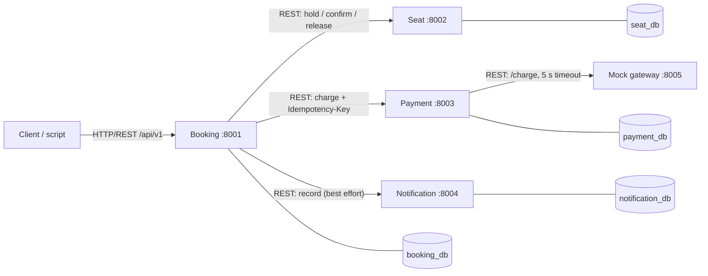
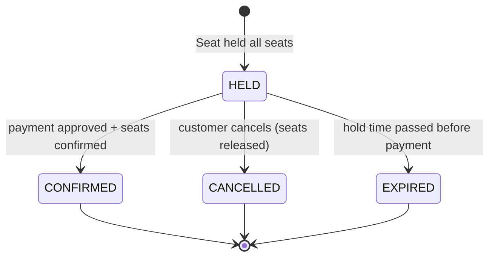
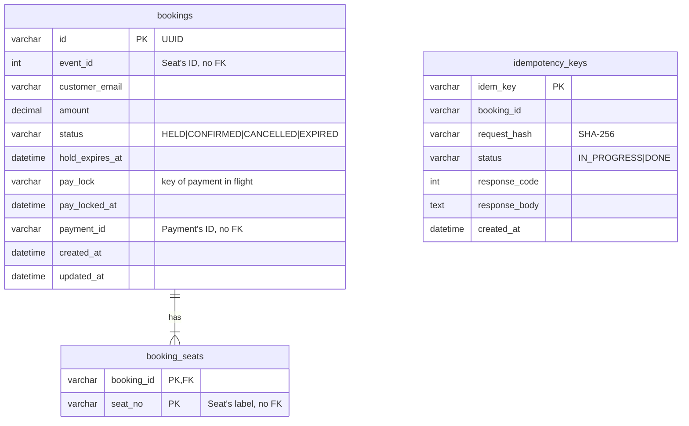

# Ticket Booking: system design and Booking service guide

This explains (1) what the assignment requires, (2) how the whole system works end to end, (3) how the Booking service is designed and why, and (4) what to do next. Diagrams are Mermaid, so they can be pasted into the report (draw.io / mermaid.live) and redrawn.

---

## 1. What the assignment requires

**Goal (13 marks):** build a microservices app that behaves correctly when requests are **concurrent, repeated or partially failing**. Design quality and reasoning count more than the number of features.

### The five conditions, and how our system meets them

| # | Condition | Our answer |
|---|---|---|
| a | ≥ 4 services with distinct responsibilities | Booking, Seat, Payment, Notification (+ mock gateway, not counted) |
| b | One transaction spanning ≥ 3 services | **Pay**: Booking → Payment (→ gateway) → Seat confirm → Notification |
| c | A contended resource that can be over-allocated | A **seat**: two customers must never get the same seat |
| d | An operation unsafe to repeat | **Payment**: a retry must never charge twice |
| e | A dependency that can be slow or fail | **Mock gateway** (`ok` / `down` / `slow`), plus Notification as a non-critical dependency |

### Mandatory technical requirements (each one is a mark risk if missing)

| Area | What is needed | Where it is in Booking |
|---|---|---|
| Services | Own folder, dependency file, database | `services/booking-service`, `requirements.txt`, `booking_db` |
| Communication | REST only; never read another DB | `app/clients.py` (HTTP); `app/db.py` touches `booking_db` only |
| Data | DB per service, separate credentials, only IDs of others' data | `booking_user`; `seat_no`, `payment_id`, `event_id` kept as plain values |
| API quality | `/api/v1`, validation, correct codes, one error format, OpenAPI | `app/api/`, pydantic, `AppError`, `docs/openapi/booking-service.json` |
| Operability | `/health`, env config, JSON logs with correlation ID passed on | skeleton + every outbound call sends `X-Correlation-Id` |
| Business rules | ≥ 4 rules, each traceable to code and test | BR3 + BR4 (Booking side) in `app/rules.py`, `test_BR3_*`, `test_BR4_*` |
| Testing | Unit test per rule + scripted end-to-end test | `tests/` (60 tests) + `scripts/e2e_booking_flow.py` |

### Engineering challenges
- **Challenge 1 – Concurrency** (mandatory): ≥ 20 parallel requests for capacity N → exactly N succeed. *Owned by Seat* (atomic `UPDATE … WHERE status='AVAILABLE'`). Booking passes Seat's 409 through, so the script can also be run against Booking.
- **Challenge 2 – Idempotency** (mandatory): same `Idempotency-Key` → same result, no second effect; same key + different body → 409/422; must work for **simultaneous** identical requests. *Payment owns the charge-level version; Booking implements it on `/pay` too* (see §3.4).
- **Challenge 3B – Time-bound holds** (team's choice): holds auto-release after ~30 s, cancel releases, expiry job safe to run twice, never releases a paid seat. *Seat owns the seat side; Booking owns the booking side* (`EXPIRED` state, `POST /bookings/expire`, cancel).

### Deliverables
GitHub repo (runs from README), report PDF ≤ 15 pages (10 sections), 8–10 min video (everyone speaks, live terminal), `/evidence` with one folder per challenge + README, contribution table, half-page reflection each, **AI-use declaration**.

Marks: decomposition 2, architecture/API 2, implementation 3, challenges 3, report/video/evidence 3. Your individual mark = team mark × your factor, based on **commit history, contribution table and the video**.

---

## 2. The whole system, end to end

### 2.1 Services and what each owns

| Service | Port | DB | Owns (only it writes this) | Rules |
|---|---|---|---|---|
| **Booking** | 8001 | booking_db | bookings, booking_seats, idempotency_keys (pay) | BR3, BR4 (Booking side), state machine |
| Seat | 8002 | seat_db | events, seats (AVAILABLE/HELD/SOLD), holds | BR1, BR2 |
| Payment | 8003 | payment_db | payments, idempotency_keys (charge) | BR4 |
| Notification | 8004 | notification_db | notification log | – |
| Mock gateway | 8005 | none | nothing (pretends to be the bank) | – |

### 2.2 Component diagram



The client only talks to Booking. Booking is the only service that calls others (orchestration). Payment is the only one that calls the gateway. No circular calls. The longest synchronous chain is Client → Booking → Payment → Gateway (3 hops), which is within the assignment's "justify anything longer than 3".

### 2.3 Main transaction (two client calls)

```mermaid
sequenceDiagram
    autonumber
    participant C as Client
    participant B as Booking
    participant S as Seat
    participant P as Payment
    participant G as Gateway
    participant N as Notification
    C->>B: POST /bookings {eventId, seats, customerEmail}
    B->>S: POST /seats/hold {bookingId, eventId, seats}
    S-->>B: 200 held (all or none)  [409 SEAT_UNAVAILABLE -> 409 to client]
    B-->>C: 201 {bookingId, status: HELD, holdExpiresAt}
    C->>B: POST /bookings/{id}/pay  (Idempotency-Key: k1)
    Note over B: save k1 as IN_PROGRESS (PK) ; BR3 check ; claim booking (pay_lock)
    B->>P: POST /payments (Idempotency-Key: k1)
    P->>G: POST /charge (timeout 5 s)
    alt gateway OK
        G-->>P: 200 APPROVED
        P-->>B: 201 {paymentId, APPROVED}
        B->>S: POST /seats/confirm
        S-->>B: 200 SOLD
        Note over B: HELD -> CONFIRMED ; save response under k1
        B--)N: POST /notifications (failure only logged)
        B-->>C: 200 {status: CONFIRMED}
    else gateway DOWN or SLOW
        G--xP: 503 / timeout
        P-->>B: 503 PAYMENT_GATEWAY_UNAVAILABLE
        Note over B: release pay_lock ; forget k1 ; booking stays HELD
        B-->>C: 503 (client may retry with k1 until the hold expires)
    end
```

### 2.4 Booking state machine


Any other change → `409 INVALID_STATE_CHANGE`. A failed payment leaves the booking HELD.

### 2.5 Business rules

| ID | Rule | Enforced in | Error | Tests |
|---|---|---|---|---|
| BR1 | A seat belongs to one booking at a time | Seat | 409 SEAT_UNAVAILABLE | Seat owner |
| BR2 | Hold expires after 30 s; a paid seat is never released | Seat | – | Seat owner |
| BR3 | Pay only while HELD and not expired | **Booking** `rules.check_payable` + `db.claim_for_payment` | 409 BOOKING_NOT_PAYABLE / HOLD_EXPIRED | `test_BR3_*` |
| BR4 | A payment is applied once per booking | **Booking** `booking_flow.pay_with_idempotency`, `rules.check_idempotent_repeat` + Payment | 422 IDEMPOTENCY_KEY_REUSED / 409 REQUEST_IN_PROGRESS | `test_BR4_*` |

---

## 3. Booking service design

### 3.1 Data (`booking_db`, see `schema.sql`)



### 3.2 Inside the service (three layers + flow)

`api/` (receive + validate) → `booking_flow.py` (order of steps, what to undo) → `rules.py` (what is allowed, pure functions) / `db.py` (SQL only) / `clients.py` (HTTP only). Rules have no web or SQL code, so they are unit-tested directly.

### 3.3 Create booking
1. Validate: `eventId > 0`, 1–6 seats, no duplicates, valid email (400 otherwise).
2. Generate the **booking ID (UUID) first**, so Seat can store it with the hold.
3. Read the clock, set `hold_expires_at = now + HOLD_SECONDS` **before** calling Seat. Seat starts its own 30 s a moment later, so Booking's deadline is never later than Seat's: Booking will not accept a payment for a hold Seat has already dropped.
4. `Seat.hold` (all-or-none). 409 → passed to client, nothing saved. Seat down/timeout → 503, and a best-effort release in case Seat did hold before failing.
5. Save booking + seats in one transaction as HELD. If saving fails → release seats (compensation).

### 3.4 Pay — the important one

| Step | What happens | Why |
|---|---|---|
| 1 | Insert `Idempotency-Key` as IN_PROGRESS (primary key) | Of N identical simultaneous requests, exactly one insert wins. Others: DONE + same hash → replay saved response; different hash → 422; IN_PROGRESS → 409 REQUEST_IN_PROGRESS |
| 2 | BR3: `check_payable(status, hold_expires_at, now)` | Clear error: BOOKING_NOT_PAYABLE / HOLD_EXPIRED |
| 3 | Atomic claim: `UPDATE bookings SET pay_lock=:key WHERE id=:id AND status='HELD' AND hold_expires_at>:now AND pay_lock IS NULL` | Two payments with **different** keys for one booking: only one gets rowcount 1. Same idea as Seat's atomic update |
| 4 | `Payment.charge` with the **same key** passed on | Payment de-duplicates too, so a retry never charges twice |
| 5 | `Seat.confirm` | Seats sold only after money is taken |
| 6 | `HELD → CONFIRMED` (only by the lock holder) | State machine enforced in SQL |
| 7 | `Notification` best effort | A notification failure must not undo a paid booking |
| 8 | Save the response under the key (DONE) | Later repeats get the identical response, header `Idempotent-Replayed: true` |

**Failure handling**

| Failure | Client gets | Booking state | Key saved? | Why |
|---|---|---|---|---|
| Gateway down / slow | 503 PAYMENT_GATEWAY_UNAVAILABLE | HELD | No (deleted) | Customer can retry with the same key |
| Payment service unreachable / > 8 s | 503 PAYMENT_SERVICE_UNAVAILABLE | HELD | No | Payment may have charged; retry with same key replays it at Payment |
| Seat down after charge | 503 SEAT_SERVICE_UNAVAILABLE | HELD | No | Retry with same key: Payment replays (no 2nd charge), confirm again |
| Seat says hold gone after charge | 409 HOLD_EXPIRED + "refund required" log | EXPIRED | Yes | Known gap: real system would refund |
| Notification down | 200 CONFIRMED | CONFIRMED | Yes | Non-critical dependency |
| Hold expired / not HELD | 409 | unchanged | Yes | Final business answer |

Rule of thumb: **final answers are saved against the key, "try again later" answers (5xx, *_IN_PROGRESS) are not.**

### 3.5 Cancel and expire
- Cancel: state check → `UPDATE … SET status='CANCELLED' WHERE status='HELD' AND pay_lock IS NULL` → then `Seat.release` (best effort; Seat's expiry job is the safety net) → notify. Booking is cancelled **before** seats are freed, so nobody can pay for a booking whose seats are gone.
- Expire: `POST /bookings/expire` runs `UPDATE … SET status='EXPIRED' WHERE status='HELD' AND hold_expires_at <= now` — touches only HELD rows, so it is safe twice and never touches CONFIRMED. Reads (`GET`, pay, cancel) also expire an overdue booking lazily, so nobody ever sees a stale HELD.

### 3.6 Design decisions to put in the report (§8)

1. **Orchestration vs choreography** → orchestration in Booking. One readable flow, easy to demo; cost: Booking knows all the others.
2. **Synchronous REST vs messaging** → REST (assignment asks for it). Cost: slow dependency slows the caller → every call has a timeout and a defined 503.
3. **Idempotency at Booking as well as Payment** → defense in depth: the client-facing unsafe operation is `/pay`, and Booking's own replay avoids re-running Seat/Notification calls.
4. **UUID booking IDs** generated by Booking → Seat can store the ID with the hold before the booking row exists.
5. **Server-side price** (`SEAT_PRICE`) → the client cannot choose what it pays.
6. **Payment timeout (8 s) > gateway timeout (5 s)** → Booking does not give up while Payment can still succeed.

### 3.7 Limitations (report §9)
- Payment can succeed just as the hold expires → logged `REFUND_REQUIRED`, no automatic refund.
- A crash mid-payment leaves `pay_lock`; it is ignored after `PAY_LOCK_TTL_SECONDS` (60).
- An IN_PROGRESS idempotency key left by a crash is not cleaned up automatically.
- Seat's and Booking's clocks are assumed in sync (same machine locally, same host in Assignment 2).
- Synchronous chain: if Payment is slow, the client waits up to 8 s.

---

## 4. Where the team documents disagree (settle these in your next sync)

The five documents were written at different times and conflict in places. The implementation follows the **Technical Architecture doc (15 Oct, the latest)** and the Solution Blueprint. Each choice is isolated in one file.

| Topic | Team Guide says | Architecture / Blueprint say | Implemented | Change in |
|---|---|---|---|---|
| Seat API | `POST /seats/{id}/hold`, one seat, body `{"bookingId"}` | `POST /seats/hold`, several seats, all-or-none | Blueprint version; body `{"bookingId","eventId","seats"}` | `app/clients.py` |
| Booking request | `{"seatId", "customerName", "amount"}` | `event_id, seats, customer_email` | `{"eventId","seats","customerEmail"}` (snake_case also accepted); amount computed by server | `app/api/schemas.py` |
| Booking ID | INT | not stated | UUID string (needed before Seat call) | – |
| Seat SOLD state name | `BOOKED` | `SOLD` | Booking does not depend on it | – |
| Who owns Challenge 2 | Payment | Blueprint: Booking (idempotency_keys in booking_db); Architecture: Payment | **Both** — Booking on `/pay`, Payment on `/payments` | – |
| Reused key status | 409 or 422 | 422 IDEMPOTENCY_KEY_REUSED | 422 | `app/rules.py` |

**Ask the Seat owner:** `confirm` must be idempotent (SOLD by the same booking → 2xx).
**Ask the Payment owner:** don't save 503 results against the key; accept `{"bookingId","amount"}`; return `status: "APPROVED"` and `paymentId`.

---

## 5. How to proceed

### 5.1 This week
1. **Read every file** in `app/` and the tests until you can explain each line — the assignment treats code you can't explain in the demo as an integrity issue, and AI use must be declared in the report appendix.
2. Run it locally: `pytest` (60 pass), then the stubs + `scripts/e2e_booking_flow.py` (see the service README).
3. Commit on your own branch in small steps, under your own name — commit history affects your individual mark. A sensible order:
   1. `schema.sql`, `seed.sql`, `.env.example`, `config.py`
   2. `db.py` + `clock.py`
   3. `rules.py` + `tests/test_rules.py` (BR3, state machine, BR4 rules)
   4. `clients.py`
   5. `booking_flow.py` + `api/` + router in `main.py`
   6. `tests/conftest.py` + `tests/test_booking_api.py`
   7. `dev/stubs.py`, scripts, README, `docs/`
4. Post §4 to the team chat; agree the Seat and Payment request shapes.
5. Open a PR; the Notification owner reviews it.

### 5.2 Integration day
1. One laptop: `docker compose up -d`, `check_db.py` (4 × OK), `run_all.ps1` with the **real** services.
2. Run `pytest` in every service.
3. `python scripts/e2e_booking_flow.py --with-expiry --out evidence/tests/e2e_output.txt`
4. `python scripts/booking_idempotency_demo.py --out evidence/challenge-2-idempotency/booking_pay_output.txt`, then the printed SQL queries → screenshot showing **one** payment row.
5. Save the Booking service log lines (replay, 503, confirmed) to `evidence/` as text.
6. Fill your rows in `evidence/traceability.md`.

### 5.3 Report sections the Booking owner writes
§3 sequence diagram (§2.3 above, with the failure branch), §5 Booking endpoint table + sample request/response, §6 Challenge 2 (Booking side) and the Booking part of 3B, §8 decisions (§3.6), §9 limitations (§3.7).

### 5.4 Video (your part, ~2 min)
Happy path live → set gateway `down` → pay → 503 and booking still HELD → set `ok` → retry same key → CONFIRMED → run the idempotency demo and show the single payment row.

### 5.5 Questions you should be ready for
- *Why not check status in Python and then update?* Two requests can both read HELD before either writes. The conditional UPDATE does check-and-change in one statement; the database serialises them and only one sees rowcount 1.
- *What if two identical pay requests arrive at once?* The primary key on `idem_key` lets one insert; the other sees IN_PROGRESS → 409, and afterwards a replay.
- *What if they use different keys?* The `pay_lock` claim lets only one through → 409 PAYMENT_IN_PROGRESS; after confirm, BR3 gives BOOKING_NOT_PAYABLE.
- *Why not save the 503?* Then the customer could never retry with the same key; retrying is safe because Payment de-duplicates by the same key.
- *Why does Notification failing not fail the booking?* The money is taken and the seat is sold; undoing that because a log write failed would be worse.
- *Why does Booking store `seat_no` and not a foreign key?* Seats live in another database; a FK would require cross-database access, which the assignment forbids.
